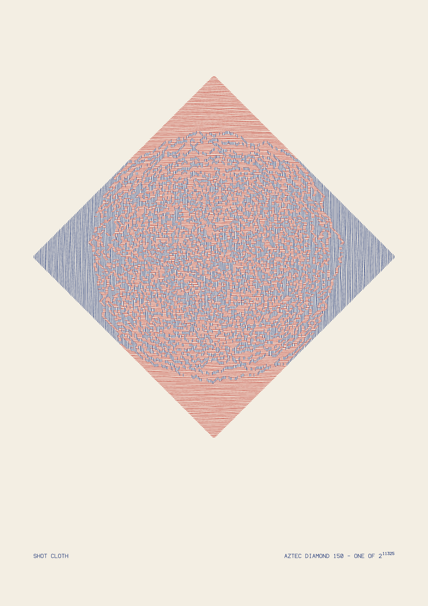

# Shot Cloth

*Aztec diamond of order 150, one of 2¹¹³²⁵ — two inks on warm white, A3*



## Artist statement

Shot silk (changeable taffeta) is woven with one colour in the warp and
another in the weft, so the cloth has no colour of its own: it shimmers
between the two depending on which thread happens to lie on top.

This sheet is that cloth, woven by chance. It is a single, exactly uniform
random tiling of the Aztec diamond by 22,650 dominoes. Every horizontal
domino is drawn as a thread of **weft** in madder red; every vertical one
as a thread of **warp** in indigo. Nothing else decides the colour.

What emerges is the arctic circle theorem made into textile. Near the four
tips the tiling *freezes*: the top and bottom go to pure weft, solid
red rules, and the left and right to pure warp, solid blue. Inside an exact
inscribed circle the dominoes stay *liquid*, the two threads interlace at
random, and the cloth goes shot: a purple you'll find in neither pen. The
circle is never drawn. No line in the program mentions a circle; its edge is
just where long-range order gives out, and it is razor sharp.

I went through the generator's own presets (one-class dissolve, horizons,
four-ink weave), four-colour compass versions, Agnes Martin-pale greys, a
small-n to large-n "emergence" triptych, and gel-on-black. I cut them all.
The four-colour versions were pretty but read as a diagram of the theorem,
and the triptych read as a lecture. The idea that held up was the textile:
two inks are all you need, because the theorem *is* a statement about warp
against weft. Then it's a picture of cloth, and the mathematics is
the reason it looks the way it does, not the subject. Up close (30 cm) it is a
basket-weave of short red and blue dashes. From across the room it is a
lozenge of shimmering cloth with a full moon woven into it. I
chose madder and indigo, the two oldest dyes in the trade, over the first
red/green trial, which read as Christmas.

The colophon gives the census: AD(150) has exactly 2^(150·151/2) =
2¹¹³²⁵ tilings, and the sampler chose this one uniformly. Re-plotting with
another seed gives a different weave and the identical circle.

## Materials

| Item | Spec |
|---|---|
| Paper | A3 (297 × 420 mm) hot-press cotton rag, warm white (≈ `#f3eee3`), 300 gsm. Canson Moulin du Roy HP or Arches Aquarelle HP. It must be hot-press: the dashes are 0.8 mm apart and cold-press tooth will break them |
| Pen 1: weft | Madder red, **`#c0392b`**, 0.3 mm pigment fineliner (Sakura Pigma Micron 03 *Red* or Copic Multiliner SP 0.3 *Wine*/*Red*) |
| Pen 2: warp + colophon | Indigo, **`#233a7a`**, 0.3 mm pigment fineliner (Sakura Pigma Micron 03 *Royal Blue*, or Staedtler pigment liner 0.3 *Blue*) |
| Other | Low-tack drafting tape, a spare sheet of the same paper for a test strip, glassine interleaf |

Both pens must be **pigment** (not dye) inks. Each pass lays ~19 m of
line, and pigment won't bleed where red and blue dashes come within
0.2 mm of each other.

## Process

1. **Fix the sheet.** Tape the A3 sheet portrait onto the plotter bed at all four
   corners. It must not move between passes. The circle only reads if the two
   threads register to within ~0.3 mm.
2. **Test strip.** On a spare sheet, plot the first ~200 strokes of
   `artwork-layer-1-weft.svg` (pause and abort). The red rules must read as
   separate lines with paper between them. If they merge, the pen is too wet or
   too broad. Swap to a fresher 0.25 mm before going on.
3. **Pass 1, weft (madder red).** Plot `artwork-layer-1-weft.svg`
   (5,305 strokes, ≈ 19.4 m of line). Swap pens if the line greys out
   mid-plot. Pigment liners usually give ~15–25 m each, so have a second
   red ready and change it at a natural pause, not mid-stroke.
4. **Dry 20 minutes.** Leave the sheet taped down. Don't lift it.
5. **Pass 2, warp (indigo).** Load the indigo pen and plot
   `artwork-layer-2-warp.svg` (5,263 strokes, ≈ 18.5 m). This pass lays
   blue dashes in the gaps between red ones. If the two passes are
   misregistered, the frozen corners will still look right but the interlace
   at the circle's centre will start to overprint. Inspect the first minute of
   the warp pass with a loupe at the diamond's centre.
6. **Pass 3, colophon (same indigo pen).** Plot
   `artwork-layer-3-colophon.svg`: "SHOT CLOTH" bottom-left, the census
   "AZTEC DIAMOND 150 - ONE OF 2¹¹³²⁵" bottom-right, aligned to the cloth's
   width.
7. **Cure** overnight flat under glassine.
8. **Present.** Float-mount on a warm-white board in a plain oak or
   undyed ash frame with a deep window (≥ 25 mm all round) so the paper edge
   shows. Hang at eye level. The piece wants two viewing distances: let
   people come up close enough to see that it is red and blue, not purple.

## Plot settings

- Sheet: A3 portrait, 297 × 420 mm; SVGs carry physical mm dimensions
  (viewBox 1188 × 1680 = 4 px/mm)
- Cloth: diamond 250 mm tip-to-tip, centred horizontally, centre 178 mm
  from top edge; colophon baseline 384 mm from top, 2.6 mm cap height
- Pen width: 0.3 mm both pens (thread pitch is 0.83 mm, so ~36%
  coverage in the frozen corners)
- Order: weft → warp → colophon. Strokes are nearest-neighbour ordered per
  layer (`orderPlot`) and deliberately **not chained**. Each domino stays
  its own short thread with its own end-caps.
- Totals: 10,624 strokes, ≈ 38.1 m pen-down. Budget roughly 3 to 4 hours
  of plotting, mostly pen-down/up cycles on the short dashes.
- `artwork.svg` is the composited reference (both inks on a paper-tone
  background) for preview only. Plot the three layer files.

## Reproduction

The `arctic` generator has no CLI command (it is core- and web-only), so a
scratch script calls `generateArctic` directly with `marks: 'all'` (all four
domino classes inked as spines), relabels the four classes into two threads
(N + S → `weft`, E + W → `warp`), adds the colophon with core's stroke font,
and writes one SVG per pen with `toSVGLayers`. Only the order (`150`) and the
seed (`3`) are inputs. Everything else is a constant in the script.

Build the repo, save the script below as `shotcloth.mjs` anywhere, and run it
**from the repo root**:

```sh
pnpm install && pnpm build
node shotcloth.mjs concept-brainstorming/2026-11-14-0611 150 3
node scripts/svg-to-png.mjs concept-brainstorming/2026-11-14-0611/artwork.svg \
  concept-brainstorming/2026-11-14-0611/preview.png --width 1600
```

Expected sha256 (verified byte-identical across two runs):

```
274fb3043aff339f0630e5186e24ea9c24643dd8fa904901551e46d28563ef21  artwork-layer-1-weft.svg
0c927c000459bf8ade3fbd716d9b94588209b2caf7dbe07cf3bba41f06fb68e1  artwork-layer-2-warp.svg
39b94639b18a0ad3064d8283fceffad16271660fb7f87faf09d2db3987d62ba5  artwork-layer-3-colophon.svg
b360b090fc49c4c874139a8e469ff483369f0bc93e8660944176de58046bdf1f  artwork.svg
```

(The `WEFT` / `WARP` / `PAPER` env vars only change preview colours. Leave
them unset to reproduce the hashes.)

```js
// shotcloth.mjs — "Shot Cloth": a uniformly random domino tiling of the Aztec
// diamond AD(n), inked as a woven cloth. Horizontal dominoes (N + S classes)
// are the WEFT, plotted in one ink; vertical dominoes (E + W) are the WARP,
// in a second. Where the tiling freezes (the four corners outside the arctic
// circle) the cloth is pure weft or pure warp; inside the circle the two
// threads interlace at random and the cloth goes "shot" — the optical mix
// of two colours that changeable taffeta is woven for.
//
//   node shotcloth.mjs <outDir> [order] [seed]
import { writeFileSync, mkdirSync } from 'node:fs';
import { join } from 'node:path';

const root = process.env.FLOW_LINES_ROOT ?? process.cwd();
const coreDist = join(root, 'packages', 'core', 'dist', 'index.js');
const { generateArctic, toSVG, toSVGLayers, orderPlot } = await import(coreDist);
const { textToStrokes, textWidth } = await import(join(root, 'packages', 'core', 'dist', 'stroke-font.js'));

const outDir = process.argv[2] ?? '.';
const ORDER = +(process.argv[3] ?? 150);
const SEED = +(process.argv[4] ?? 3);
const WEFT_INK = process.env.WEFT ?? '#c0392b';
const WARP_INK = process.env.WARP ?? '#233a7a';
const PAPER = process.env.PAPER ?? '#f3eee3';
mkdirSync(outDir, { recursive: true });

const PXPMM = 4;
const mm = (v) => v * PXPMM;
const SHEET_W = 297, SHEET_H = 420;      // A3 portrait
const CLOTH_MM = 250;                      // diamond tip-to-tip
const CLOTH_CY = 178;                      // diamond centre, mm from top
const WOBBLE = 1.0;                        // px — threads, not ruled lines

// 1. The cloth: generate in its own square box, then place on the sheet.
const box = mm(CLOTH_MM);
const cloth = generateArctic({
  width: box, height: box, margin: 0, seed: SEED, order: ORDER,
  marks: 'all', upright: false, wobble: WOBBLE, optimize: false,
});
const ox = (mm(SHEET_W) - box) / 2;
const oy = mm(CLOTH_CY) - box / 2;
const THREAD = { 'domino-n': 'weft', 'domino-s': 'weft', 'domino-e': 'warp', 'domino-w': 'warp' };
const lines = cloth.lines.map((l) => ({
  layer: THREAD[l.layer],
  points: l.points.map((p) => ({ x: p.x + ox, y: p.y + oy })),
}));

// 2. Colophon, in the warp pen (no extra pen change): title left, the
//    tiling's census right — AD(n) has exactly 2^(n(n+1)/2) tilings.
const add = (text, xMm, yMm, sizeMm, align = 'left') => {
  const size = mm(sizeMm);
  let x = mm(xMm);
  if (align === 'right') x -= textWidth(text, size);
  for (const s of textToStrokes(text, x, mm(yMm), size)) lines.push({ layer: 'colophon', points: s });
  return textWidth(text, size);
};
const exp = String((ORDER * (ORDER + 1)) / 2);
const BASE_Y = 384, CAP = 2.6, SUP = 1.8;
const left = (SHEET_W - CLOTH_MM) / 2;
const right = SHEET_W - left;
add('SHOT CLOTH', left, BASE_Y, CAP);
const supW = textWidth(exp, mm(SUP)) / PXPMM;
const mainText = `AZTEC DIAMOND ${ORDER} - ONE OF 2`;
add(mainText, right - supW - 0.8, BASE_Y, CAP, 'right');
add(exp, right, BASE_Y - 1.3, SUP, 'right');

let result = orderPlot({ lines, width: mm(SHEET_W), height: mm(SHEET_H), seed: SEED });

const common = {
  strokeWidth: 0.3 * PXPMM, precision: 2, includeBackground: false,
  physicalWidth: `${SHEET_W}mm`, physicalHeight: `${SHEET_H}mm`,
  layerColors: { weft: WEFT_INK, warp: WARP_INK, colophon: WARP_INK },
};
const names = { weft: 'artwork-layer-1-weft.svg', warp: 'artwork-layer-2-warp.svg', colophon: 'artwork-layer-3-colophon.svg' };
for (const { layer, svg } of toSVGLayers(result, common)) writeFileSync(join(outDir, names[layer]), svg);
writeFileSync(join(outDir, 'artwork.svg'), toSVG(result, { ...common, includeBackground: true, backgroundColor: PAPER }));

const stat = {};
for (const l of result.lines) {
  const s = (stat[l.layer] ??= { strokes: 0, mm: 0 });
  s.strokes++;
  for (let i = 1; i < l.points.length; i++) s.mm += Math.hypot(l.points[i].x - l.points[i - 1].x, l.points[i].y - l.points[i - 1].y) / PXPMM;
}
console.log(JSON.stringify(stat));
```

## Wishes

- **An `arctic` CLI command** (`--order`, `--marks`, `--upright`, `--seed`,
  `--split-layers`). The generator is core-only today, so this piece needs
  a scratch script.
- **Class-grouping for pens**: an option like `--pens weft-warp` that maps
  the four domino classes onto two pen layers (N+S, E+W). That is exactly the
  relabel this script does by hand, and the warp/weft reading is
  the strongest two-ink use of the generator.
- **A non-square Aztec region** (e.g. the "Aztec rectangle" or a tilted
  hexagon for lozenge tilings). Then the frozen boundary becomes an ellipse
  or other algebraic curve, and a whole bolt of shot cloth could run across
  a multi-sheet `--tile` panel.
