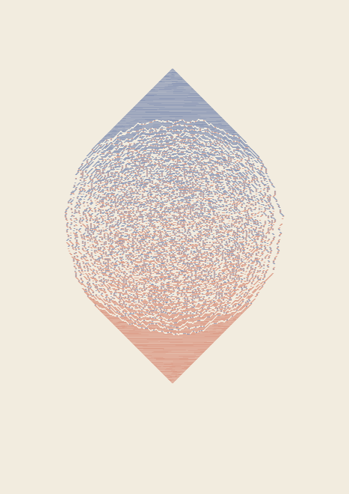

# Temperate Zone



## Artist statement

Take a diamond-shaped floor of 88,620 squares and tile it with 44,310
dominoes, choosing uniformly at random among every tiling there is (a
number with more than 13,000 digits). You would expect noise. You don't
get it. In 1998 Jockusch, Propp and Shor proved that as the diamond
grows, the tiling splits into two phases: near the four corners the
dominoes freeze into perfectly regular brick courses, and inside a
circle they stay disordered. The theorem's own vocabulary is
geographical. The frozen corners are the **polar regions**, the
disordered interior is the **temperate zone**, and the boundary between
them is the **arctic circle**.

This sheet inks only the two horizontal domino classes, and gives each
its own pen. The north-facing dominoes are plotted in cold blue and the
south-facing ones in warm red. Where a class is frozen, its spines weld
into unbroken rules, so the two poles come out as solid ice caps of
colour. The east and west poles hold only vertical dominoes, which are
not inked, so they stay as bare paper. Inside the circle the two pens
break into short dashes and interleave, with blue thinning out toward
the bottom and red toward the top. The result is a temperature gradient
that comes from counting alone. Where the order breaks down, a hairline
of reserved paper runs around the circle. Nothing in the algorithm
mentions a circle, and there is no shading anywhere in the code. The
tone, the gradient and that edge are all consequences of combinatorics.

**Why this survived the cull.** The first renders came from the new
`arctic` generator, which no studio session had used yet. Its default
single-class "dissolve" looked like a teardrop that wanted a reason to
exist. The four-ink weave read as busy, even confetti, because when
every class is inked everywhere the circle carries no tone. I also tried
a four-sheet "the law becomes true as n grows" polyptych (n = 5, 15, 45,
135). I dropped it because the small-n sheets were too thin to stand as
pictures. That left two pens, two poles and two blank flanks. It reads
at three distances. From across a room it is a seed, a lens or a small
planet. At arm's length you see weather. Close up it is a woven field
of 10,000 dashes, each of which is just a domino. I would pin it up.

## Materials

- **Paper:** Fabriano Artistico Traditional White, hot-pressed, 300 gsm,
  A3 (297 × 420 mm), portrait. Hot-press keeps the 0.25 mm rules crisp,
  and the warm "traditional white" (≈ `#f2ecdf`) is what the preview
  approximates.
- **Pen 1 (south / warm):** Sakura Pigma Micron 01 (0.25 mm), **Red**,
  ≈ `#c4472a`.
- **Pen 2 (north / cold):** Sakura Pigma Micron 01 (0.25 mm), **Royal
  Blue**, ≈ `#1f3f8a`.
- **Other:** low-tack masking tape or a plotter clamp. For the colophon,
  an HB pencil and a soft white eraser.
- **Mount:** float-mounted on 2 mm off-white mount board in a plain oak
  frame, with at least 50 mm of air on every side. The blank flanks are
  part of the drawing, so don't crop into them with a tight window mat.

## Process

1. Acclimatise the sheet for an hour, then fix it to the plotter bed in
   portrait with tape on all four edges. The sheet must not move between
   passes, because the two colours interlock at domino scale inside the
   circle.
2. Home the plotter to the sheet's top-left corner. Both SVGs are full
   A3 pages with identical coordinates, so registration is automatic as
   long as nothing moves.
3. **Pass 1: `artwork-layer-1-south-red.svg`** with the Red Micron 01.
   5,096 strokes, about 14.4 m of line. Use moderate speed so the welded
   pole rules don't skip.
4. Swap pens without unclamping. The two classes never overlap (dominoes
   don't overlap), so there is no wet-on-wet risk, but give the red about
   10 minutes anyway so a hand resting near the sheet can't smear it.
5. **Pass 2: `artwork-layer-2-north-blue.svg`** with the Royal Blue
   Micron 01. 5,068 strokes, about 14.4 m.
6. Let it dry for an hour. Then, in HB pencil, 20 mm below the bottom
   point of the diamond and centred, write lightly:
   `AD(210) · seed 4 · 44,310 dominoes`. Sign and number it at the lower
   right, printmaker style.
7. Float-mount it and frame it.

`artwork.svg` is the two layers composited in their preview colours. Use
it for reference and proofing only. Plot from the two layer files.

## Plot settings

| | |
|---|---|
| Sheet | A3, 297 × 420 mm, portrait |
| Image | diamond inside a 267 mm square, centred horizontally, centre 192 mm from the top (optical centre). Side margins 15 mm, top 58.5 mm, bottom 94.5 mm (room for the colophon) |
| Lattice | Aztec diamond order 210. Cell pitch ≈ 0.64 mm, so the pole rules are about 0.64 mm apart under a 0.25 mm pen (≈ 40 % ink cover) |
| Pens | 2 passes, both 0.25 mm |
| Ink | ≈ 28.8 m of line in total, about 10,160 strokes. Stroke order is optimised (`orderPlot`, reorder-only, so dominoes never fuse) |

## Reproduction

```sh
pnpm install && pnpm build
# from the repo root:
node temperate.mjs concept-brainstorming/2026-11-15-0612
```

`temperate.mjs` (run from the repo root):

```js
// Temperate Zone — reproduces every SVG in this folder byte-for-byte.
//   pnpm install && pnpm build
//   node temperate.mjs <outDir>
import { writeFileSync } from 'node:fs';
import { join, resolve } from 'node:path';

const core = await import(resolve('packages/core/dist/index.js'));
const { generateArctic, toSVG } = core;
const out = process.argv[2] ?? '.';

const MM = 96 / 25.4;                 // SVG px per mm
const PAGE_W = 297, PAGE_H = 420;     // A3 portrait
const BOX = 267;                      // diamond bounding square, mm (15 mm side margins)
const CENTRE_Y = 192;                 // diamond centre, mm from top (optical centre, above middle)
const SEED = 4, ORDER = 210;
const PEN_MM = 0.25;

const side = Math.round(BOX * MM);
const r = generateArctic({ width: side, height: side, margin: 0, seed: SEED, order: ORDER, marks: 'horizontals', upright: false });

const dx = (PAGE_W * MM - side) / 2;
const dy = CENTRE_Y * MM - side / 2;
const lines = r.lines.map((l) => ({ ...l, points: l.points.map((p) => ({ x: p.x + dx, y: p.y + dy })) }));
const page = { width: Math.round(PAGE_W * MM), height: Math.round(PAGE_H * MM), seed: SEED };
const svgOpts = { strokeWidth: PEN_MM * MM, physicalWidth: `${PAGE_W}mm`, physicalHeight: `${PAGE_H}mm` };

const pick = (layer) => ({ ...page, lines: lines.filter((l) => l.layer === layer) });
const south = pick('domino-s'), north = pick('domino-n');
writeFileSync(join(out, 'artwork-layer-1-south-red.svg'), toSVG(south, { ...svgOpts, strokeColor: '#c4472a' }));
writeFileSync(join(out, 'artwork-layer-2-north-blue.svg'), toSVG(north, { ...svgOpts, strokeColor: '#1f3f8a' }));
writeFileSync(join(out, 'artwork.svg'), toSVG({ ...page, lines }, { ...svgOpts, layerColors: { 'domino-s': '#c4472a', 'domino-n': '#1f3f8a' } }));

const len = (ls) => ls.reduce((a, l) => a + l.points.slice(1).reduce((s, p, i) => s + Math.hypot(p.x - l.points[i].x, p.y - l.points[i].y), 0), 0) / MM / 1000;
console.log(`south: ${south.lines.length} strokes, ${len(south.lines).toFixed(1)} m · north: ${north.lines.length} strokes, ${len(north.lines).toFixed(1)} m`);
```

Expected sha256:

```
a24b913a832ca1874b84573383382c93a653f0614323a4b5bf50058e77004d8f  artwork-layer-1-south-red.svg
fe5d086008abd7beaad38083700066f10e23a2acfce69ffd5170bae81802df93  artwork-layer-2-north-blue.svg
d98499d6e80a23601214fe2e615f1ff018437be9e9c84a50d0c3afd2504976bf  artwork.svg
```

Preview:

```sh
node scripts/svg-to-png.mjs concept-brainstorming/2026-11-15-0612/artwork.svg \
  concept-brainstorming/2026-11-15-0612/preview.png --width 1600 --background '#f2ecdf'
```

## Wishes

- **An `arctic` CLI command** with `--order`, `--marks`, `--upright`,
  `--split-layers` and a page-placement offset. This piece needs a
  scratch script only to place the diamond off-centre on a portrait
  sheet and to split the classes into files.
- **Per-class mark choice.** For example, ink N/S as spines but E/W as a
  sparse dot at each domino centre. That would turn the bare flanks into
  a third, quieter texture without making the circle confetti.
- **Lozenge (hexagon) tilings.** Their limit shape is an inscribed
  ellipse with *six* frozen facets, and three pen classes would give a
  natural three-ink version of the same idea.
