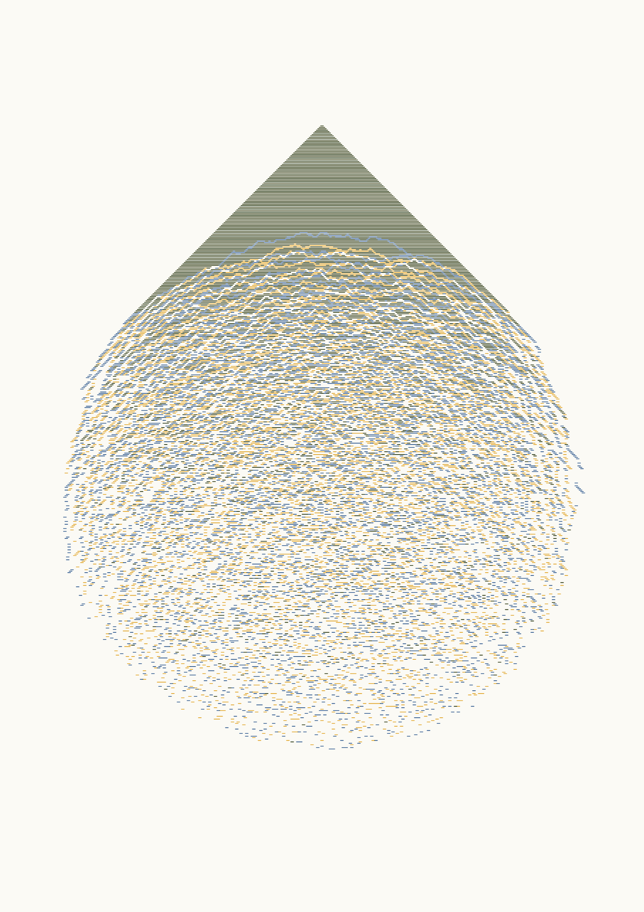

# Concordance



## Artist statement

Two coins were thrown about thirty-four thousand times each. Each run of
throws built a domino tiling of a 260-step Aztec diamond, sampled exactly
and uniformly at random by domino shuffling. From each tiling I kept only
the dominoes that point north and drew one line down the middle of each.
Neither tiling knows the other exists.

Then both are plotted on the same sheet, on the same lattice. One pen holds
a transparent yellow and the other a transparent Prussian blue. **No pen
holds green.** Green shows up only where the two random tilings happen to
put the same domino in the same place.

The arctic circle theorem (Jockusch–Propp–Shor, 1998) predicts what
happens next. At the top of the diamond the tiling has no freedom left:
every random tiling freezes into the same brick courses, so the two passes
land on each other line for line and the point of the drop turns solid
green. Inside the inscribed circle the tilings are "liquid" and each one
goes its own way, so the round body of the drop breaks into yellow dashes
and blue dashes. The odd green dash there is two coins agreeing by chance.
Between these two zones runs a thin fringe, which is my favourite part of
the piece. There one tiling has already melted while the other is still
frozen. The disagreement draws itself as long yellow-only and blue-only
contour lines that hang inside the green like isobars.

I picked this one because the idea fits in a single sentence, *colour
appears only where chance agrees*, and the material does the arguing. The
plot file contains no green anywhere, so the green on the paper is real.
It also reads at two distances. From across a room it is a single drop,
dark at the tip and dissolving toward the bottom. Up close it is a dense
weave of short marks with two colours tangled through it. I tried and
discarded other versions: the four-ink `weave` (all four classes, one pen
each) looks like an illustration of a theorem rather than a picture of
anything; a three-seed overprint muddied the agreeing tip to brown and
lost the surprise; and the obvious approach of calling `generateArctic`'s
`marks:'one'` per seed fits each seed to its own bounding box, so the two
"identical" frozen tips came out at slightly different scales and moiréd
against each other. That moiré was pretty, but it said the opposite of
the idea.

## Materials

- **Paper:** A3 (297 × 420 mm), bright-white **hot-press** cotton
  watercolour paper or smooth Bristol, 250–300 gsm (for example Arches
  Aquarelle Hot Press 300 gsm, or Strathmore 500 Bristol Plate). It must be
  white, not cream, because yellow ink disappears on toned stock and the
  piece depends on the yellow staying visible.
- **Ink 1, gamboge:** a *transparent dye-based* warm yellow, about
  `#e3a21a` (for example Diamine Sunshine Yellow fountain-pen ink).
- **Ink 2, Prussian blue:** a *transparent dye-based* mid-dark blue, about
  `#1f4e8c` (for example Diamine Prussian Blue).
- **Pens:** two 0.3 mm refillable technical pens (or plotter-mounted
  fountain pens), one per ink. Pigment fineliners will work, but they are
  more opaque and give a duller, darker green, so the transparent dye inks
  are worth the trouble.
- Low-tack drafting tape or a vacuum/magnetic bed. **The sheet must not
  move between the two passes.**

## Process

1. Tape the sheet to the plotter bed, portrait, with the origin at the
   sheet's top-left corner. Do not move the sheet again until step 5.
2. Load the **gamboge** pen and plot `artwork-layer-1-gamboge.svg` at
   100 % (it is already 297 × 420 mm). The lighter ink goes first, so the
   blue lands on top of it and glazes it green.
3. Let it dry for at least **30 minutes**. Dye ink that is still wet will
   bleed into the second pass and turn the tip into a solid wash, which
   destroys the line structure.
4. Swap in the **Prussian blue** pen at the same height and plot
   `artwork-layer-2-prussian.svg`. Don't nudge or re-home the paper. Any
   slight misregistration from the machine itself (about 0.1 mm) is fine
   and helps: the agreeing lines become a doubled green-edged stroke, the
   way a hand retracing a line would leave it.
5. Let it dry overnight, then remove the tape.
6. Sign and title it in pencil in the empty band below the drop (it ends
   about 80 mm above the bottom edge). Float-mount it in a white box frame
   with at least 50 mm of white mount all round so the drop has room.

## Plot settings

- A3 portrait, 297 × 420 mm. The drawing spans x ≈ 28–270 mm and
  y ≈ 58–339 mm. Margins are built in, so plot with no offset.
- One 0.3 mm pen per layer, two layers.
- Layer 1 (gamboge, seed 11): 7,793 strokes, ~22.6 m pen-down,
  ~14.4 m pen-up travel.
- Layer 2 (Prussian, seed 22): 7,836 strokes, ~22.9 m pen-down,
  ~14.4 m pen-up travel.
- 689 strokes (~4.7 m) are byte-identical between the two files. Those are
  the agreement.
- Thousands of short dashes means lots of pen lifts, so plot at a moderate
  speed and use a pen-lift delay that lets the nib settle each time.

## Reproduction

From the repo root, after `pnpm install && pnpm build`, save the script
below as `concordance.mjs` and run `node concordance.mjs <outDir>`. It
writes both layer SVGs byte-for-byte (sha256 below) and `preview.svg`.
Rasterise the preview with
`node scripts/svg-to-png.mjs <outDir>/preview.svg preview.png --width 1600`.
The preview SVG uses `mix-blend-mode: multiply` to imitate transparent
ink overprinting. It is for viewing only and should not be plotted.

```js
// Concordance — two independent uniformly random domino tilings of the
// Aztec diamond AD(260), inking only the north-going dominoes of each, placed
// on the identical lattice and overprinted in two transparent inks.
//   node final.mjs <outDir>      (run from the repo root after `pnpm build`)
import { writeFileSync } from 'node:fs';
import { join, resolve } from 'node:path';
const out = resolve(process.argv[2] ?? '.');
const { generateArctic, toSVG, orderPlot, measurePenTravel } = await import(resolve('packages/core/dist/index.js'));

const K = 4;                       // px per mm
const W = 297 * K, H = 420 * K;    // A3 portrait
const PEN = 0.3 * K;               // 0.3 mm pen, both passes
const D = 340 * K;                 // diamond tip-to-tip (only its top half is ever inked)
const dx = (W - D) / 2, dy = 58 * K; // diamond's top tip 58 mm below the sheet's top edge
const ORDER = 260;
const PASSES = [
  { seed: 11, file: 'artwork-layer-1-gamboge.svg', ink: '#e3a21a' },
  { seed: 22, file: 'artwork-layer-2-prussian.svg', ink: '#1f4e8c' },
];

const layers = PASSES.map(({ seed }) => {
  // marks:'all' pins generateArctic's fit box to the full diamond (its four
  // tips are always frozen), so every seed lands on the identical lattice;
  // then keep only the north class. wobble 0 so agreeing strokes coincide exactly.
  const r = generateArctic({ width: D, height: D, margin: 0, seed, order: ORDER, marks: 'all', wobble: 0, optimize: false });
  const lines = r.lines
    .filter((l) => l.layer === 'domino-n')
    .map((l) => ({ ...l, points: l.points.map((p) => ({ x: p.x + dx, y: p.y + dy })) }));
  return orderPlot({ lines, width: W, height: H, seed });
});

const page = { strokeWidth: PEN, physicalWidth: '297mm', physicalHeight: '420mm' };
PASSES.forEach((p, i) => {
  writeFileSync(join(out, p.file), toSVG(layers[i], { ...page, strokeColor: p.ink }));
  const t = measurePenTravel(layers[i]);
  console.log(p.file, layers[i].lines.length, 'strokes', JSON.stringify(t));
});

// Preview only (not for plotting): the two passes multiplied like transparent ink.
const body = (r, ink) => toSVG(r, { strokeColor: ink, strokeWidth: PEN }).replace(/^[\s\S]*?<svg[^>]*>/, '').replace(/<\/svg>\s*$/, '');
writeFileSync(join(out, 'preview.svg'), `<svg xmlns="http://www.w3.org/2000/svg" viewBox="0 0 ${W} ${H}" width="${W}" height="${H}"><rect width="${W}" height="${H}" fill="#fbfaf5"/>
${PASSES.map((p, i) => `<g style="mix-blend-mode:multiply">${body(layers[i], p.ink)}</g>`).join('\n')}</svg>`);
```

```
b4081d33b08f7228c250cef51a9c0639e5fffeae56d7f24588b9d1297f02448e  artwork-layer-1-gamboge.svg
e4bb923f3b03397f39f46cef455da85c6b04cb37fa18b191c8564f55d300b8dc  artwork-layer-2-prussian.svg
```

## Wishes

- An **Arctic CLI command** (or a stack-recipe generator), so this can be
  reproduced without a scratch script.
- A **`fit: 'diamond'`** option for `generateArctic`. Today the fit box
  is the bounding box of whatever marks get inked, so overprinting several
  seeds or classes only lines up through the `marks:'all'` + filter
  workaround above. Fitting to the full diamond would make multi-seed and
  multi-class layering a first-class move.
- A **multi-seed overprint mode** for Arctic (N seeds → N pen layers on one
  lattice). The agreement/disagreement idea generalises: CMY across three
  seeds, or one seed per year of a series.
