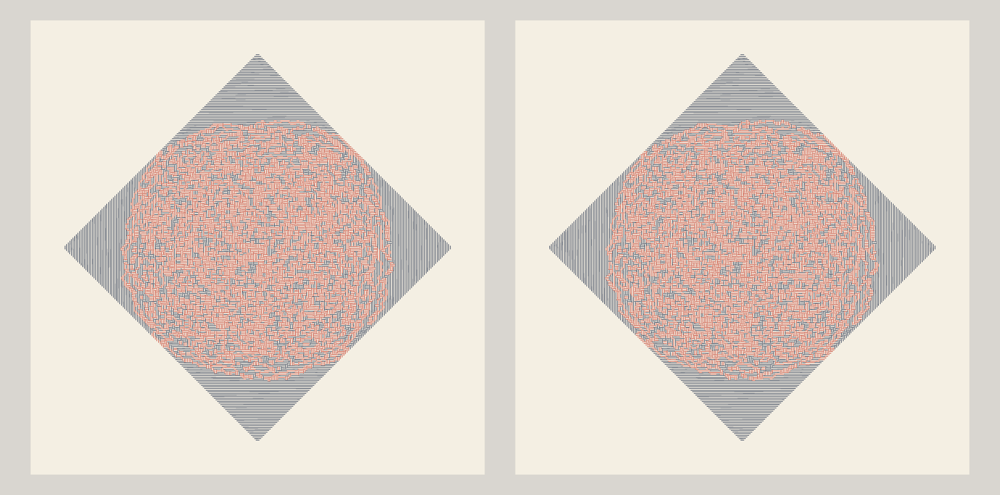

# The Circle Nobody Drew

*Diptych — two square sheets, 297 × 297 mm each, pigment fineliner on hot-pressed cotton rag.*



## Artist statement

Take a diamond-shaped board and tile it with dominoes, choosing — out of the
astronomically many possible tilings — one completely at random. Do it again,
independently. The two outcomes are strangers, yet they turn out to agree on
almost everything near the four corners: there the dominoes are *forced* into
perfect brick courses, and every random tiling looks the same. Only inside a
region bounded by an exact circle does chance get any say. The algorithm never
mentions a circle (the Arctic Circle theorem, Jockusch–Propp–Shor 1998). The
circle appears because of the maths.

These two sheets are two such tilings, sampled independently (seeds 2026 and
1121) at order 120 — 14 520 dominoes each, every domino inked as a single
stroke along its length. Every domino the two tilings **share** is plotted in
blue-black, from **one and the same file** on both sheets. Every domino a tiling
does **not** share with its twin is plotted in red. So the blue-black is common
ground and the red is what each one owns alone. Both
sheets carry the same solid striped diamond corners, and the same scattered
blue-black islands inside the circle (agreement is symmetric, so the islands
match exactly from sheet to sheet). The red differs everywhere. Look from one
panel to the other and the "spot the difference" game *is* the theorem: the
differences are all inside the circle.

**Why this one survived.** I began with the cat-in-snow photograph (paper as
snow, which was promising, but the 320 px source can't hold a face), went on to
op-art warp gratings (handsome, but generic), and then the new Arctic module's
presets. Overlaying several seeds was the turn: wherever the tilings agreed,
the circle cut itself out of the corners as a clean hole. A five-seed overlay
gave a red disc in a grey diamond, which was graphic but closed to the eye and
far too dense to plot. Two seeds, drawn as twins, keeps the woven kilim
texture readable up close (blue-black weft islands floating in red), gives a
bold emblem at room distance, and turns a probability result into
something you can see without being told. It is about agreement, chance, and
the shape that emerges between two random lives. Up close it reads like a
Bauhaus weaving study. From across the room it reads like a flag.

## Materials

| Item | Specification |
|---|---|
| Paper | 2 sheets **Arches Aquarelle Hot Press 300 gsm, Natural White** (≈ `#f4efe3`), cut to **297 × 297 mm** (an A3 sheet with 61.5 mm trimmed from each short end, or cut from a full sheet). Hot press for the crispest line, natural white so the red stays warm. |
| Pen 1 — common ground | **Sakura Pigma Micron 03, Blue Black** (0.35 mm line, ≈ `#22304a`) |
| Pen 2 — each sheet's own | **Sakura Pigma Micron 03, Red** (0.35 mm line, ≈ `#c43d2b`) |
| Spares | One fresh Micron of each colour **per sheet**. Each layer is ≈ 15 m of line, enough to start drying out a 03 tip by the end. |
| Registration | Low-tack drafting tape; a pencil and a set square for a corner mark. |
| Presentation | Two identical 400 × 400 mm white box frames, window mounts cut to 260 × 260 mm (the diamond is 253 mm tip to tip; the window shows a whisper of paper around the tips). Hang with a 60 mm gap between them, the "a" sheet on the left. |

## Process

1. **Cut and mark.** Cut both sheets to 297 × 297 mm. On the back of each, in
   the top-left corner, pencil a small **a** or **b** and an arrow pointing up.
   The two sheets must never swap orientation, since the frozen corners are
   orientation-specific.
2. **Tape down sheet a** square in the plotter's origin corner (use the set
   square against the bed edges). Pencil a tiny tick at the sheet's top-left
   corner on the bed tape so sheet b lands in exactly the same place.
3. **Plot `common.svg` on sheet a** with the **Blue Black** Micron 03.
   That is ≈ 2 900 strokes / 15 m of line. Swap in a fresh pen halfway if the
   rules in the lower corner start to grey out.
4. **Without moving the sheet, swap to the Red** Micron 03 and **plot
   `sheet-a.svg`**. That is ≈ 5 500 strokes / 15 m. Micron pigment is dry to the
   touch within a minute, and the two layers barely overlap, so no drying wait
   is needed between pens. Don't rest a hand on the sheet for 10 minutes
   afterwards.
5. **Remove sheet a, tape sheet b** to the same corner tick.
6. **Plot `common.svg` again — the identical file — on sheet b** with the Blue
   Black pen.
7. **Swap to Red and plot `sheet-b.svg`.**
8. Any registration error between the blue-black and red passes is
   acceptable and even welcome (sub-millimetre). The red dominoes fill gaps
   between blue-black ones and never need to touch them exactly.
9. **Sign** in pencil below the lower tip of each diamond, centred: title,
   "a" / "b", and the seeds (`2026` / `1121`). Mount and frame as described
   above.

## Plot settings

- Virtual paper: **297 × 297 mm**, square. The diamond is centred, with 22 mm
  clear margin to its tips.
- Pen width: **0.35 mm** for both pens (SVG stroke width matches).
- Pen up/down: standard. Every mark is a straight segment, either a single
  domino or a welded rule. Ordering is done with `orderPlot` (reorder only, no
  chaining, so domino ends stay crisp).
- Approximate drawn length: `common.svg` 15.2 m, `sheet-a.svg` 15.4 m,
  `sheet-b.svg` 15.4 m. The whole diptych is ≈ 61 m of line in 4 plotting
  passes.
- Files are in SVG px with a physical `width="297mm" height="297mm"` and a
  viewBox of `0 0 891 891` (3 px/mm).

## Reproduction

Configuration only. This is a scratch driver over the built core (`shuffleAztec`,
`applyHandDrawnStyle`, `orderPlot`, `toSVG`) from the Arctic generator. It uses
the generator's own uniformly-random domino-shuffling sampler and its
spine-and-weld mark logic. The scratch part is the agreement split between
two seeds.

```sh
pnpm install && pnpm build
# save the script below as /tmp/circle.mjs, then from the repo root:
node /tmp/circle.mjs concept-brainstorming/2026-11-21-0607
```

Output is byte-identical on re-run (`common.svg` md5 `0b025cdf…`,
`sheet-a.svg` `ceae8dc6…`, `sheet-b.svg` `2c891765…`).

```js
// The Circle Nobody Drew — two independent uniformly-random domino tilings of
// the Aztec diamond AD(120). Dominoes both tilings share → common.svg (plotted
// on BOTH sheets); each tiling's own dominoes → sheet-a.svg / sheet-b.svg.
import { writeFileSync, mkdirSync } from 'node:fs';
const { shuffleAztec, applyHandDrawnStyle, orderPlot, toSVG } =
  await import(`${process.cwd()}/packages/core/dist/index.js`); // run from the repo root
const out = process.argv[2] ?? '.';
mkdirSync(out, { recursive: true });

const ORDER = 120, SEED_A = 2026, SEED_B = 1121;
const W = 297, H = 297, MARGIN = 22, PPM = 3, PEN = 0.35, WOBBLE = 0.35, WOBBLE_SEED = 7;

const A = shuffleAztec(ORDER, SEED_A), B = shuffleAztec(ORDER, SEED_B);
const key = (d) => `${d.x},${d.y},${d.h ? 1 : 0}`;
const inB = new Set(B.map(key));
const inA = new Set(A.map(key));

// Diamond spans [-n, n] cells both ways; centre it in the square sheet.
const k = ((W - 2 * MARGIN) * PPM) / (2 * ORDER);
const P = (x, y) => ({ x: (W * PPM) / 2 + x * k, y: (H * PPM) / 2 - y * k });
// Spine along the domino's long axis — collinear neighbours share endpoints.
const spine = (d) => d.h
  ? { a: P(d.x, d.y + 0.5), b: P(d.x + 2, d.y + 0.5), h: true }
  : { a: P(d.x + 0.5, d.y), b: P(d.x + 0.5, d.y + 2), h: false };

// Weld collinear touching spines into single rules (frozen order → long lines).
function weld(segs) {
  const kk = (p) => `${Math.round(p.x * 4)},${Math.round(p.y * 4)}`;
  const ends = new Map();
  for (const s of segs) for (const p of [s.a, s.b]) {
    const q = kk(p); if (!ends.has(q)) ends.set(q, []); ends.get(q).push(s);
  }
  const used = new Set(), lines = [];
  for (const s of segs) {
    if (used.has(s)) continue; used.add(s);
    const pts = [s.a, s.b];
    for (const end of [0, 1]) for (;;) {
      const tip = end ? pts[pts.length - 1] : pts[0];
      let grew = false;
      for (const c of ends.get(kk(tip)) ?? []) {
        if (used.has(c) || c.h !== s.h) continue;
        const other = kk(c.a) === kk(tip) ? c.b : c.a;
        used.add(c); end ? pts.push(other) : pts.unshift(other); grew = true; break;
      }
      if (!grew) break;
    }
    lines.push({ points: [pts[0], pts[pts.length - 1]] });
  }
  return lines;
}

function write(name, dominoes) {
  let res = { lines: weld(dominoes.map(spine)), width: W * PPM, height: H * PPM, seed: SEED_A };
  res = applyHandDrawnStyle(res, { amplitude: WOBBLE, wavelength: 90, jitter: WOBBLE * 0.3, seed: WOBBLE_SEED });
  res = orderPlot(res);
  writeFileSync(`${out}/${name}`, toSVG(res, {
    strokeWidth: PEN * PPM, physicalWidth: `${W}mm`, physicalHeight: `${H}mm`,
  }));
  console.log(name, res.lines.length, 'strokes');
}
write('common.svg', A.filter((d) => inB.has(key(d))));
write('sheet-a.svg', A.filter((d) => !inB.has(key(d))));
write('sheet-b.svg', B.filter((d) => !inA.has(key(d))));
```

`preview.png` is a diptych mock-up. Both panels are composited on natural-white
paper (`#f4efe3`): the blue-black is `#22304a` and the red is `#c43d2b`, with
multiply blending. It was rasterised with
`node scripts/svg-to-png.mjs preview.svg preview.png --width 2400`. The
composite `preview.svg` was made in the scratchpad: it wraps the three SVGs'
`<path>` elements in two translated, recoloured groups.

## Wishes

- **A `stack`/CLI path for comparative sampling.** This is "render the
  generator twice at different seeds and split the marks by set agreement
  (∩ / A∖B / B∖A)". As a generic compose operation over any two layers'
  lines, it would turn many seeded generators into a diptych like this one.
- **`arctic` as a CLI command** with `--marks`, `--order` and
  `--split-layers`, so this piece's single-seed cousins need no scratch script.
- **Exported `spineMarks`/`weld` helpers** (currently internal to
  `core/src/arctic/marks.ts`). The weld step had to be copied into the script.
