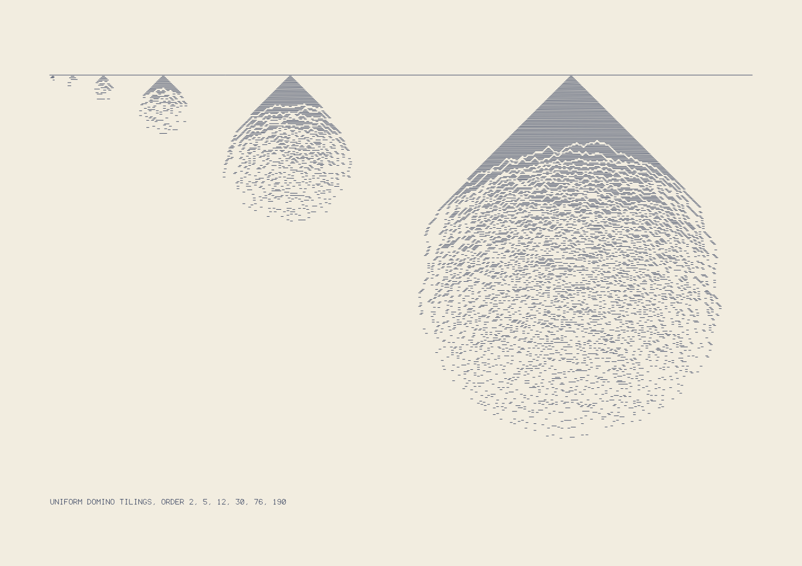

# Learning to Be Round

*Six domino tilings hanging from one line. Pen and blind-debossed line on
cream hot-press, A3 landscape, 2026.*



## Artist statement

A line runs across the top of the sheet, and six drops hang from it, from
left to right. The first is a speck. The second is a few scattered dashes.
By the third you can see a point at the top. By the last there's a real
drop, 19 cm across: a dense wedge of ruled lines that breaks along a
crisp, fissured arc into a loose rain of dashes and thins away at the
bottom.

Nothing in the drawing is shaded and nothing in the code draws a drop.
Each shape is an exactly uniform random tiling of an Aztec diamond by
dominoes, and only one of the four domino orientations is inked. The
*arctic circle theorem* says that as the diamond grows, its corners
freeze into perfect brickwork while the inside stays random, and the
border between the two becomes a sharp circle. The inked class freezes at
the top, so its spines weld into solid rules there. Below that they break
into dashes, and further down they nearly vanish. That gives the
drop shape.

The theorem only holds in the limit, and that's what the piece is about.
Every drop uses the same grain (half a millimetre per lattice square, one
0.25 mm nib) and only the number of dominoes changes: 2, 5, 12, 30, 76,
190. The small ones are honest noise. The circle hasn't arrived yet,
and you watch it settle in, the way a drop gathers under a gutter before
it falls. I kept this one because it uses the new Arctic generator to show
the one thing it's for (order appearing out of pure chance at scale)
rather than a single pretty instance of it. The left half of the sheet
stays nearly empty to give the growth room to read. When I stand back I
see a dripping eave, and up close I see the combinatorics.

What survived the cull, and what didn't:
- *Four-ink compass diamond* (all four classes, one colour each): too
  busy. The centre turned into a woven grid that read as mechanical.
- *Two adjacent classes* (N + W): the vertical class turned to confetti.
- *Two-ink "horizon" lens*: handsome but a single specimen, and the
  preset almost does it alone.
- *Upright square, one class*: the frozen corner lost its point and with
  it the drop.
- *Wash band above the ledge* (a pale indigo "underside of a wet
  surface"): it muddied the cream to grey and flattened the composition.
  I dropped it for the blind deboss described below, which makes the
  ledge physical without adding tone.
- *Four-stage and three-stage rows*: the jump between stages was too big
  to read as growth. Six stages, each about 2.5× the last, reads as a
  time-lapse.

## Materials

| Item | Spec |
|---|---|
| Paper | A3 (420 × 297 mm) hot-pressed 100% cotton watercolour paper, **natural / cream white** (≈ #F2EDE0), 300 gsm. Arches Aquarelle Hot Press Natural White or Fabriano Artistico Extra White HP. The smooth surface matters, because 0.5 mm-pitch rules must not catch on tooth. |
| Ink pen | **0.25 mm pigment fineliner, blue-black** (≈ #1C2A4D). Sakura Pigma Micron 01 *Blue-Black*, or Copic Multiliner SP 0.25 *Cobalt*/*Blue Black* if you're refilling. Use a fresh pen: the big drop's frozen wedge alone is several metres of dense ruled line. |
| Deboss stylus | A dry, spent ballpoint refill (0.7–1.0 mm ball) or an embossing stylus clamped in the pen holder, used to press the ledge line into the paper before inking. |
| Other | Low-tack drafting tape, a scrap sheet of the same paper for the test plot, and a float mount + 30 mm-deep box frame with spacers (see Presentation). |

## Process

1. **Condition the sheet.** Let the paper sit flat in the room for an hour.
   Tape it to the plotter bed with low-tack tape on all four corners,
   landscape, origin at the top-left corner of the sheet.
2. **Test plot.** On the scrap sheet, plot only a 40 × 30 mm window of the
   big drop's apex (or simply run the full file on scrap at 50 % speed and
   stop after a minute). Check that adjacent rules 0.5 mm apart stay
   separate lines and don't flood into a solid. If they merge, slow the
   plot down or swap to a 0.2 mm (005) nib. Don't change the file.
3. **Blind deboss (stylus pass).** Fit the dry stylus with firm pen-down
   pressure (heavier spring, or a 20–30 g weight on the holder) and plot
   `ledge-deboss.svg`. It traces the 368 mm ledge line three times in the
   same place, which presses a crisp groove into the cotton. Don't move
   the sheet afterwards.
4. **Ink pass.** Swap to the 0.25 mm blue-black fineliner at normal
   pressure, *without* re-homing the paper, and plot `artwork.svg`. Its
   ledge is drawn exactly in the groove, so the ink line sits in a channel
   that catches raking light, and every drop hangs from a physical edge.
   Plot at a moderate speed (≈ 30–40 mm/s pen-down). Dense short dashes
   at high speed skip.
5. **Watch the nib.** The 190-order drop is about 60 % of the ink. If the
   line greys during the frozen wedge, pause and swap to a fresh identical
   pen. Paths are ordered, not chained, so a mid-plot swap only
   needs the plotter's resume, with no re-registration.
6. **Dry and flatten.** Let it dry for 30 minutes (pigment ink on hot-press
   paper is touch-dry in minutes, but the wedge is dense). Then leave it
   under a clean board overnight to settle any cockle.
7. **Sign** in graphite, small, bottom right, level with the caption line
   (y ≈ 262 mm).

**Presentation.** Float-mount it on a slightly warmer cream board inside a
30 mm-deep box frame, lit from the side if possible, so the debossed ledge
casts its hairline shadow. Hang it so the ledge sits at or a little above
eye level: the drops should hang *down* from where you look.

## Plot settings

| | |
|---|---|
| Sheet | A3 landscape, 420 × 297 mm (`width="420mm" height="297mm"`, viewBox 1680 × 1188, 4 px/mm) |
| Ledge | y = 39.4 mm, x = 26 → 394 mm |
| Drops | apexes on y = 40 mm. Diamond widths 2, 5, 12, 30, 76, 190 mm (0.5 mm per lattice unit), gaps 7/8/10/12/15 mm, row centred |
| Caption | 2.6 mm stroke-font at y ≈ 262 mm, left-aligned at x = 26.5 mm |
| Pens | stylus (deboss pass, 3×) then one 0.25 mm blue-black fineliner |
| Pen-down travel | ≈ 13.8 m in 5,174 strokes (`artwork.svg`), mostly short dashes, so plot time is dominated by pen lifts. Expect 1.5–2.5 h depending on the plotter. |

## Reproduction

From the repo root at the commit this folder was added in:

```sh
pnpm install && pnpm build
node round.mjs concept-brainstorming/2026-11-24-0611   # writes artwork.svg + ledge-deboss.svg
node scripts/svg-to-png.mjs concept-brainstorming/2026-11-24-0611/artwork.svg \
  concept-brainstorming/2026-11-24-0611/preview.png \
  --width 1600 --background '#f2ede0' --stroke '#1c2a4d'
```

Seeds 1–6 (one per drop, left to right), orders 2, 5, 12, 30, 76, 190,
`marks: 'one'`, default wobble (0.35 px). Expected SHA-256:

```
1b3e88d9cf349f13fcae3ef499cc889293059a58fb04d6768c3c9133492bf9f3  artwork.svg
d73a7ac99d0c318c8816619fdfa6dd370b8637013bdcd12106e08b6e8fc143f1  ledge-deboss.svg
```

`round.mjs` (save at the repo root; it isn't committed, so this listing is
the source of truth):

```js
// round.mjs — "Learning to Be Round": six uniformly random Aztec-diamond
// domino tilings of growing order, one domino class inked, hung from a
// common ledge at constant grain (0.5 mm per lattice unit). Run from the
// repo root after `pnpm build`:  node round.mjs <outDir>
import { writeFileSync, mkdirSync } from 'node:fs';
import { join } from 'node:path';

const core = join(process.cwd(), 'packages', 'core', 'dist');
const { generateArctic, toSVG, orderPlot } = await import(join(core, 'index.js'));
const { textToStrokes } = await import(join(core, 'stroke-font.js'));

const outDir = process.argv[2] ?? '.';
mkdirSync(outDir, { recursive: true });

const PX = 4;                       // px per mm in the viewBox
const mm = (v) => v * PX;
const SHEET_W = 420, SHEET_H = 297; // A3 landscape
const UNIT = 0.5;                   // mm per lattice unit — constant grain
const LEDGE_Y = 40;                 // mm: the line every drop hangs from
const ORDERS = [2, 5, 12, 30, 76, 190];
const SEEDS = [1, 2, 3, 4, 5, 6];
const GAPS = [7, 8, 10, 12, 15];    // mm between neighbouring diamonds
const LEDGE_X = [26, 394];
const CAPTION = 'UNIFORM DOMINO TILINGS, ORDER 2, 5, 12, 30, 76, 190';
const CAPTION_X = 26.5, CAPTION_Y = 262, CAPTION_SIZE = 2.6;

const sizes = ORDERS.map((n) => 2 * n * UNIT); // AD(n) spans 2n units
const total = sizes.reduce((a, b) => a + b, 0) + GAPS.reduce((a, b) => a + b, 0);
let x = (SHEET_W - total) / 2;

const lines = [];
ORDERS.forEach((order, i) => {
  const s = sizes[i];
  const r = generateArctic({
    width: mm(s), height: mm(s), margin: 0,
    seed: SEEDS[i], marks: 'one', order, optimize: false,
  });
  const ox = mm(x), oy = mm(LEDGE_Y);
  for (const l of r.lines) lines.push({ points: l.points.map((p) => ({ x: p.x + ox, y: p.y + oy })) });
  x += s + (GAPS[i] ?? 0);
});

const ledge = { points: [{ x: mm(LEDGE_X[0]), y: mm(LEDGE_Y - 0.6) }, { x: mm(LEDGE_X[1]), y: mm(LEDGE_Y - 0.6) }] };
lines.push(ledge);
for (const s of textToStrokes(CAPTION, mm(CAPTION_X), mm(CAPTION_Y), mm(CAPTION_SIZE))) lines.push({ points: s });

const svgOpts = { strokeWidth: 0.25 * PX, strokeColor: '#000', physicalWidth: `${SHEET_W}mm`, physicalHeight: `${SHEET_H}mm` };
const art = orderPlot({ lines, width: mm(SHEET_W), height: mm(SHEET_H) });
writeFileSync(join(outDir, 'artwork.svg'), toSVG(art, svgOpts));
// The stylus pass: the ledge alone, three times, for a blind deboss.
const deboss = { lines: [ledge, ledge, ledge], width: mm(SHEET_W), height: mm(SHEET_H) };
writeFileSync(join(outDir, 'ledge-deboss.svg'), toSVG(deboss, svgOpts));

let travel = 0;
for (const l of art.lines) for (let k = 1; k < l.points.length; k++)
  travel += Math.hypot(l.points[k].x - l.points[k - 1].x, l.points[k].y - l.points[k - 1].y);
console.log(`artwork.svg: ${art.lines.length} strokes, ${(travel / PX / 1000).toFixed(1)} m pen-down`);
```

## Wishes

- **Constant-grain fitting in `generateArctic`.** The page fit always
  scales the diamond to the box, so constant grain across sizes had to come
  from sizing each box to `2·n·unit` by hand. A `unitMm`/`cellPx` option
  (box = lattice × grain) would make series like this a one-liner, and it
  would also let the web module show "same pen, more dominoes" directly.
- **Arbitrary class subsets.** `marks` offers one / horizontals / all /
  outline. Adjacent pairs (N + W) or three-of-four only work by filtering
  the `all` output by layer. A `classes: ['N','W']` option would make
  that a first-class choice.
- **A deboss/stylus layer convention.** Pressure-only passes (blind
  emboss, scoring for folds) keep coming up in these sessions. A named
  `deboss` layer that the SVG export emits with a recognisable stroke (and
  that previews render as a faint shadow) would make them part of the
  file instead of the instructions.
