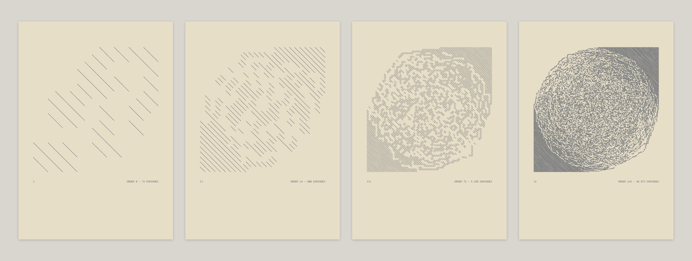

# A Moon Nobody Drew

*Four plates. One rule, one seed (3). Only the size changes: n = 8, 24, 72, 216.*



## Statement

Each plate is an exactly uniform random tiling of an Aztec diamond by
dominoes, sampled by domino shuffling. Two of the four domino classes are
inked as welded spines, and the diamond is turned 45°. Nothing in the
algorithm mentions a circle. At **n = 8** there are 72 dominoes and the
plate is a few diagonal strokes with no form. At **n = 24** two hatched
corners start to pull apart. At **n = 72** a lumpy disc of broken dashes
shows. At **n = 216**, with 46,872 dominoes, there is a moon: a grey,
cratered disc between two etched wedges of night sky, and a thin halo of
bare paper around its rim. That halo is the arctic circle
(Jockusch–Propp–Shor). It shows up as a law of large numbers. Nobody drew it.

This survived the cull because the idea is the picture. A single
arctic-circle plate is a known mathematical image. The **sequence** turns
it into a piece about emergence: you watch order form from chance across a
metre of wall, and the last plate looks like a 19th-century etched moon
study. The 45° ruled corners read as an engraver's line, so the tone is
real hatching and not a filter. I also tried the one-class "dissolve"
teardrop, the four-colour weave (handsome but too close to the textbook
figure) and warp-grid op-art (pleasant but generic). I dropped all of them.

## Materials

- **Paper:** 4 sheets of A4 (210 × 297 mm), hot-pressed cotton rag in a
  natural/warm white, about 300 gsm (for example Arches Aquarelle Hot Press,
  Natural White, ≈ #f3eee2). Cut them from one full sheet so the tone
  matches.
- **Plate pen:** Sakura Pigma Micron **01** (0.25 mm), **Blue-Black** (≈ #1c2a44).
- **Caption pen:** Sakura Pigma Micron **005** (0.20 mm), same Blue-Black.
- **Platemark:** a bone folder and a steel rule (hand step, optional but recommended).
- **Presentation:** four identical float-mount frames hung in a row, 40 mm
  apart (about 1 m wide in total). They could also be sold as a boxed
  portfolio set.

## Process

1. Tape each sheet to the plotter bed in portrait, registered to the
   top-left corner. Each sheet uses its own SVG. They are physically
   independent, so no cross-sheet registration is needed.
2. Plot `plate-N.svg` with the Micron 01 Blue-Black, at a slow speed for
   plate 4 (about 11k short strokes). The fine dashes need a clean pen-down;
   test on scrap first. Check the nib after plate 3 and use a fresh pen for
   plate 4, because a starved nib will grey the frozen corners unevenly.
3. Without moving the sheet, swap to the Micron 005 and plot
   `plate-N-caption.svg` (the plate numeral bottom-left and
   "ORDER n – dominoes" bottom-right).
4. Let the ink dry for 30 minutes. **Platemark:** on the back of the sheet,
   score a rectangle with the bone folder against the steel rule, **8 mm
   outside the 170 mm plate square** (x 12–198 mm, y 27–213 mm from the
   top-left). Burnish lightly from the front so a soft debossed edge frames
   each plate like an intaglio print.
5. Sign and edition in pencil below the platemark, on the right
   (e.g. "1/10"), as with etchings.
6. Hang in order I → IV, left to right.

## Plot settings

| | |
|---|---|
| Paper | A4 portrait, 210 × 297 mm, ×4 sheets |
| Plate | 170 mm square, top-left at (20, 35) mm |
| Captions | 2.2 mm cap height, 12 mm below the plate |
| Pens | 0.25 mm (plates), 0.20 mm (captions); the SVG stroke widths match |
| Pen-down ink length | I: 1.0 m · II: 2.9 m · III: 8.8 m · IV: 26.5 m |
| Strokes | I: 26 · II: 149 · III: 1,224 · IV: 10,942 (orderPlot-reordered, not chained, so the domino ends stay crisp) |

## Reproduction

From the repo root, after `pnpm install && pnpm build`, run the script below
as `node plates.mjs <outDir>`. It regenerates all eight SVGs
byte-for-byte (checked by re-running and `cmp`). The core is `generateArctic`
with `preset: 'horizon'`, `upright: true`, `seed: 3`, default wobble 0.35 px
at 3 px/mm, and `order` ∈ {8, 24, 72, 216}.

```js
// A Moon Nobody Drew — four A4 plates, one rule, one seed, only n changes.
// Usage: node plates.mjs <outDir>   (run from the flow-lines repo root after `pnpm build`)
import { writeFileSync } from 'node:fs';
import { join, resolve } from 'node:path';
const core = await import(resolve('packages/core/dist/index.js'));
const { textToStrokes, textWidth } = await import(resolve('packages/core/dist/stroke-font.js'));
const { generateArctic, toSVG, orderPlot } = core;

const out = process.argv[2];
const SEED = 3;
const ORDERS = [8, 24, 72, 216];
const NUMERALS = ['I', 'II', 'III', 'IV'];
const K = 3;                  // px per mm (core BASE_PX_PER_MM)
const W = 210, H = 297;       // A4 portrait, mm
const PANEL = 170, TOP = 35;  // square plate, mm
const PEN = 0.25, CAP_PEN = 0.2;

ORDERS.forEach((n, i) => {
  const ox = ((W - PANEL) / 2) * K, oy = TOP * K;
  const art = generateArctic({
    width: PANEL * K, height: PANEL * K, margin: 0, seed: SEED,
    preset: 'horizon', order: n, upright: true, optimize: false,
  });
  const lines = art.lines.map((l) => ({ ...l, points: l.points.map((p) => ({ x: p.x + ox, y: p.y + oy })) }));
  const plate = orderPlot({ lines, width: W * K, height: H * K, seed: SEED });

  const cap = [];
  const sz = 2.2 * K, y = (TOP + PANEL + 12) * K;
  const left = NUMERALS[i];
  const right = `ORDER ${n} - ${(n * (n + 1)).toLocaleString('en-GB')} DOMINOES`;
  for (const s of textToStrokes(left, ox, y, sz)) cap.push({ points: s, layer: 'caption' });
  for (const s of textToStrokes(right, ox + PANEL * K - textWidth(right, sz), y, sz)) cap.push({ points: s, layer: 'caption' });
  const caption = orderPlot({ lines: cap, width: W * K, height: H * K, seed: SEED });

  const svg = (res, pen) => toSVG(res, { strokeWidth: pen * K, physicalWidth: `${W}mm`, physicalHeight: `${H}mm` });
  writeFileSync(join(out, `plate-${i + 1}.svg`), svg(plate, PEN));
  writeFileSync(join(out, `plate-${i + 1}-caption.svg`), svg(caption, CAP_PEN));
  console.log(`plate ${i + 1}: n=${n}, ${plate.lines.length} strokes`);
});
```

`preview.png` composites the four plates, rasterized with
`scripts/svg-to-png.mjs … --width 1000 --background '#f3eee2' --stroke '#1c2a44'`
(plates and captions multiplied), on a gallery-grey wall.

## Wishes

- An `arctic` CLI command. The generator is web/core only, so this run
  needed a scratch script.
- A `--sequence` / small-multiples helper: one generator with a parameter
  swept across N tiles or sheets, with shared captions. Sequences are a
  strong format and currently need hand layout.
- A "platemark" page option that plots a faint ruled rectangle as a guide
  for the hand-scored deboss.
